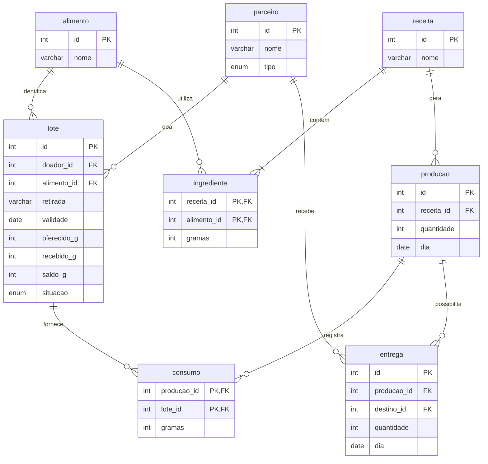

# Documentação — Projeto Kayode

O **Kayode** é um aplicativo desktop para acompanhar doações de alimentos e o preparo de marmitas. O sistema usa **Python/Tkinter** e **MySQL** e tem **7 telas**.

## Diagrama Entidade-Relacionamento (ER)

**PK**: chave primária; **FK**: chave estrangeira. O script completo está em [banco.sql](banco.sql).

## Tutorial de uso

**Antes de iniciar:** instale Python 3.10+ e MySQL 8.0.16+, execute `banco.sql` no MySQL Workbench, copie `config.exemplo.ini` como `config.ini` e configure a conexão. Instale o pacote com `python -m pip install -r requirements.txt` e abra o aplicativo usando `python app.py`.

1. **Parceiros:** cadastre **Horta do Vale** como **Doador** e **Cozinha do Bairro** como **Destino**.
2. **Doações:** para Horta do Vale, cadastre arroz cru (5 kg), feijão cru (3 kg) e abóbora limpa (4 kg). Informe um local de retirada. Para os itens com rótulo, use uma data de validade futura. Para a abóbora sem data no rótulo, deixe a validade vazia.
3. **Recebimento:** selecione cada lote e confirme todo o peso informado. Assim, a situação muda de **Pendente** para **Recebido**.
4. **Estoque:** confira o saldo e os avisos de validade; lotes vencidos não participam do cálculo.
5. **Receitas:** crie a receita **Arroz, feijão e abóbora** com 50 g de arroz, 30 g de feijão e 80 g de abóbora por marmita.
6. **Produção:** escolha a receita e meta de 80. O rendimento inicial será **50 marmitas** (arroz 100, feijão 100, abóbora 50). Faltam **2,4 kg de abóbora** para atingir 80. Registre a nova doação e confirme-a no Recebimento; depois calcule de novo. O rendimento passa a **80**. Clique em **Produzir a quantidade da meta** para descontar os ingredientes.
7. **Distribuição:** escolha a produção, selecione Cozinha do Bairro, informe 80 marmitas e registre a entrega.

## Lógica principal

O rendimento é o menor valor entre `saldo_em_gramas // gramas_por_marmita` para cada ingrediente. **Somente lotes recebidos e não vencidos** entram na previsão. Ao produzir, o sistema baixa o estoque dentro de uma transação do banco; ao entregar, impede quantidade acima do saldo de marmitas disponíveis.

## Organização do código

- `app.py`: abre o aplicativo, controla as telas e valida os dados digitados.
- `interface.py`: contém funções reutilizáveis de títulos, campos, botões e tabelas.
- `banco.py`: operações MySQL, transações e cálculo de rendimento.
- `banco.sql`: oito tabelas, chaves e relacionamentos.

**Para a defesa:** mostre a sequência das sete telas, explique o cálculo de 50 para 80 marmitas e abra o diagrama ER para mostrar como doações, estoque, produção e entregas se relacionam.

*Exemplos didáticos com nomes fictícios.*
