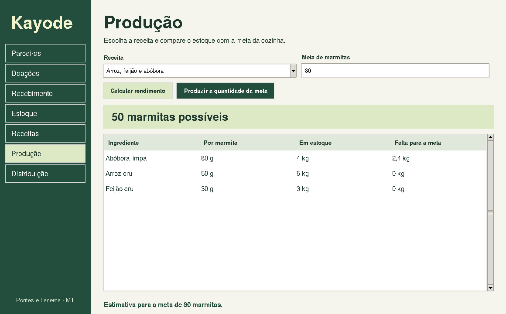

# Projeto Kayode

Aplicativo de **doação de alimentos e planejamento de marmitas**, desenvolvido em Python com **Tkinter e MySQL**. Registra doações, controla o estoque e ajuda a planejar refeições para distribuição social.



## O que o sistema faz

- **Parceiros:** cadastra doadores e locais de entrega.
- **Doações:** registra alimentos, quantidades e retirada.
- **Recebimento:** confere ou recusa os lotes.
- **Estoque:** mostra saldos e alerta sobre validade.
- **Receitas:** define ingredientes e porções.
- **Produção:** calcula e registra marmitas preparadas.
- **Distribuição:** controla entregas e quantidades.

## Como executar

Requisitos: **Python 3.10+** e **MySQL 8.0.16+**.

1. No MySQL Workbench, execute o arquivo `banco.sql`.
2. Copie `config.exemplo.ini` para `config.ini` e informe sua conexão MySQL.
3. Na pasta do projeto, execute:

```bash
python -m pip install -r requirements.txt
python app.py
```

No Windows, você também pode usar `py` no lugar de `python`.

## Como funciona o cálculo

O programa divide o **saldo de cada ingrediente** pela **quantidade necessária por marmita**. O menor resultado determina quantas refeições completas podem ser produzidas. Somente lotes recebidos e não vencidos entram no cálculo.

## Arquivos principais

| Arquivo | Função |
| --- | --- |
| [app.py](app.py) | As sete telas e as ações do usuário |
| [interface.py](interface.py) | Aparência, campos, botões e tabelas |
| [banco.py](banco.py) | Conexão MySQL e regras do sistema |
| [banco.sql](banco.sql) | Estrutura das oito tabelas |

**Documentação:** [Tutorial de uso](docs/tutorial.md) · [Diagrama ER](docs/diagrama-er.md) · [Vídeo de demonstração](docs/demonstracao.mp4)

Projeto acadêmico. Os exemplos do tutorial utilizam dados fictícios.
