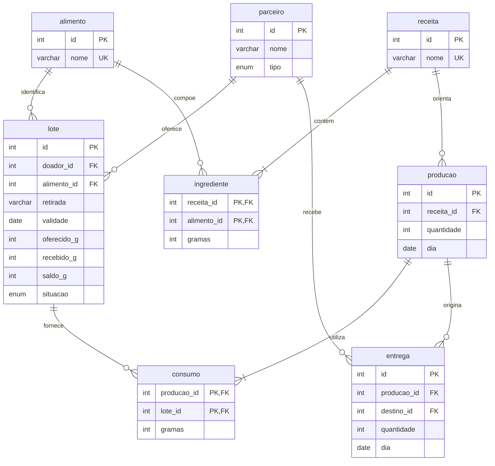

# Diagrama entidade-relacionamento

Cada lote identifica um alimento oferecido por um doador. Uma receita contém vários ingredientes. Ao preparar uma receita, a cozinha registra quanto retirou de cada lote. As entregas ligam a produção aos parceiros que recebem as marmitas.

**PK** identifica a chave primária. **FK** identifica uma referência a outra tabela. **UK** indica um valor único. Em `parceiro`, a combinação de nome e tipo é única. Em `ingrediente` e `consumo`, a chave primária é formada pelos dois campos marcados. Em `lote`, a validade pode ficar vazia quando o alimento in natura não possui data no rótulo.

[Consultar o script MySQL](../banco.sql)
