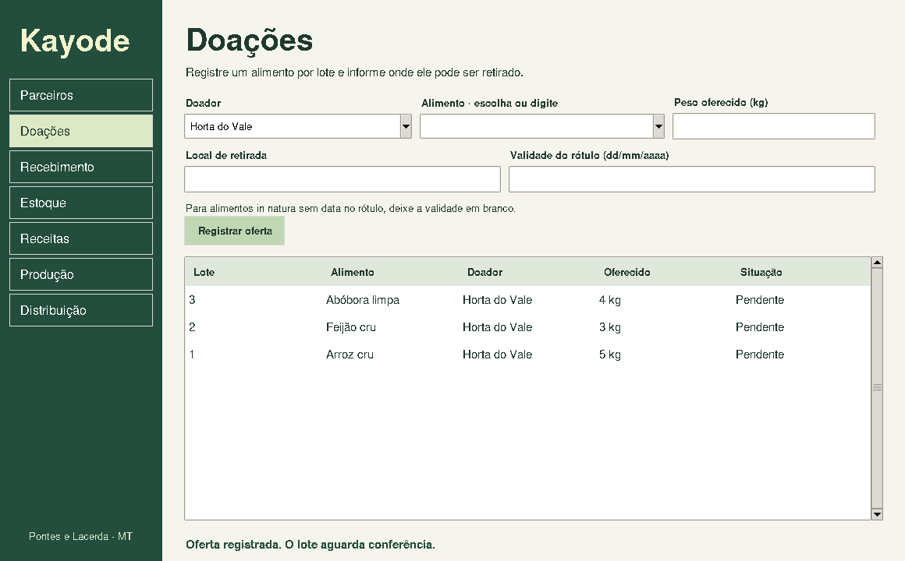
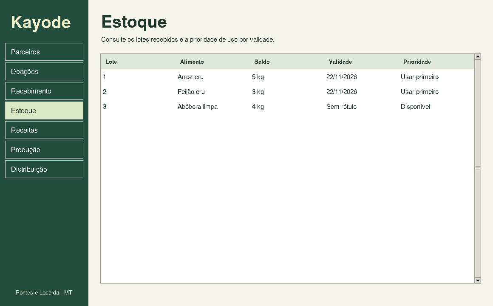
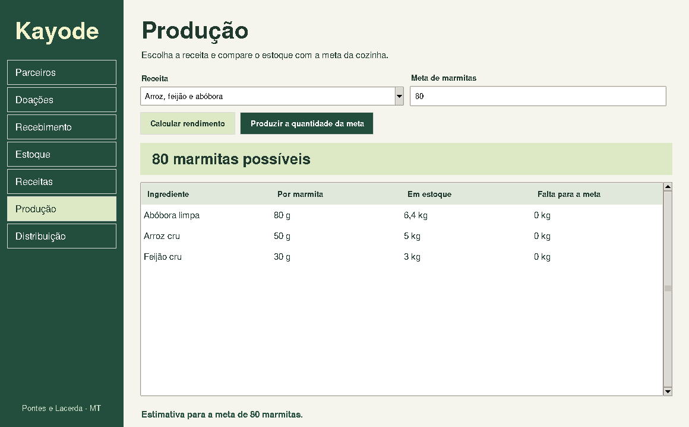
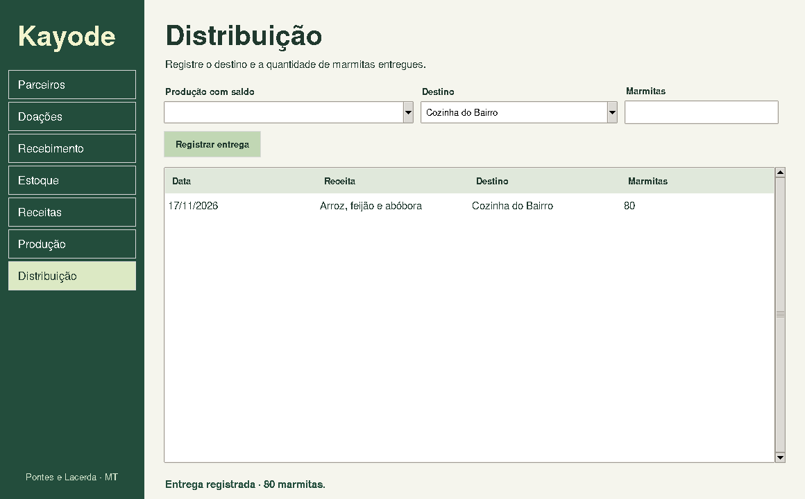

# Tutorial de uso

Este roteiro começa com o banco vazio e termina com a entrega de 80 marmitas. Os pesos da receita são exemplos didáticos. Em todas as telas o menu da esquerda permite mudar de etapa.

## 1. Cadastre os parceiros

Em **Parceiros**, digite **Horta do Vale**, escolha **Doador** e clique em **Cadastrar parceiro**. Repita com **Cozinha do Bairro** e o tipo **Destino**. O primeiro nome aparecerá nas doações e o segundo nas entregas.

## 2. Registre três ofertas

Abra **Doações**. Para cada linha da tabela, escolha Horta do Vale, informe o alimento e o peso, preencha o local com **Feira do bairro** e clique em **Registrar oferta**. Selecione o nome existente sempre que o mesmo alimento aparecer de novo.

| Alimento | Peso oferecido | Validade |
| --- | --- | --- |
| Arroz cru | 5 kg | Para o exemplo, use uma data futura no formato dd/mm/aaaa. |
| Feijão cru | 3 kg | Use a data do rótulo. Na demonstração, escolha uma data futura. |
| Abóbora limpa | 4 kg | Para o alimento in natura sem data no rótulo, deixe o campo em branco. |

Digite apenas o número no campo de peso. Todos os lotes começam como **Pendente**.

## 3. Confira o recebimento

Em **Recebimento**, selecione a primeira linha, informe o peso aprovado e clique em **Confirmar recebimento**. Repita para os outros lotes. Neste exercício, aproveite os 5 kg de arroz, 3 kg de feijão e 4 kg de abóbora. Se apenas parte de uma doação estiver adequada, registre só o peso aproveitável. Para rejeitar toda a oferta, selecione a linha e clique em **Recusar lote**.

## 4. Consulte o estoque

Abra **Estoque**. Verifique os pesos recebidos. Lotes com validade nos próximos sete dias aparecem com **Usar primeiro**. Um lote vencido ainda com saldo aparece como bloqueado e fica fora do cálculo.

## 5. Monte a receita

Em **Receitas**, digite **Arroz, feijão e abóbora**. Escolha **Arroz cru**, informe **50** gramas por marmita e clique em **Adicionar ingrediente**. Repita com **Feijão cru** e **30** gramas, depois com **Abóbora limpa** e **80** gramas. Confira os três ingredientes na tabela e clique em **Salvar receita**.

## 6. Calcule o que falta e confirme o preparo

Em **Produção**, selecione a receita, defina a meta de **80** e clique em **Calcular rendimento**. O arroz rende 100 porções (5.000 ÷ 50), o feijão rende 100 (3.000 ÷ 30) e a abóbora rende 50 (4.000 ÷ 80). A cozinha consegue fazer **50 marmitas completas**. Para chegar a 80, precisa de 6.400 g de abóbora. Como tem 4.000 g, faltam **2,4 kg**.

Volte a **Doações** e registre mais **2,4** kg de **Abóbora limpa**. Enquanto o lote estiver pendente, a produção continuará em 50. Confirme o novo peso em **Recebimento** e volte a **Produção**. O rendimento passa a **80 marmitas**.

Após o preparo, clique em **Produzir a quantidade da meta**. O sistema registra 80 marmitas e desconta os ingredientes dos lotes, começando pelos que vencem antes. O novo saldo será 1 kg de arroz, 0,6 kg de feijão e zero de abóbora.

## 7. Registre a entrega

Em **Distribuição**, escolha a produção com 80 disponíveis, selecione **Cozinha do Bairro**, digite **80** e clique em **Registrar entrega**. O histórico mostrará a data, a receita, o destino e a quantidade. Também é possível dividir uma produção entre destinos, registrando uma entrega de cada vez até esgotar o saldo.

## Roteiro curto para a defesa

1. **Apresente o problema.** “Um comércio tem alimentos que pode doar. A cozinha precisa saber o que realmente recebeu e quantas pessoas consegue atender com aquela receita.”
2. **Mostre a conta.** Abra Produção com o estoque inicial. Aponte os 4 kg de abóbora, a porção de 80 g e o resultado de 50 marmitas.
3. **Faça uma mudança ao vivo.** Registre os 2,4 kg que faltam. Mostre que a oferta pendente só altera a previsão depois do recebimento.
4. **Feche o percurso.** Confirme a produção e registre a entrega. No diagrama, mostre que a tabela consumo liga uma produção aos lotes utilizados e a tabela entrega registra o destino das marmitas.
